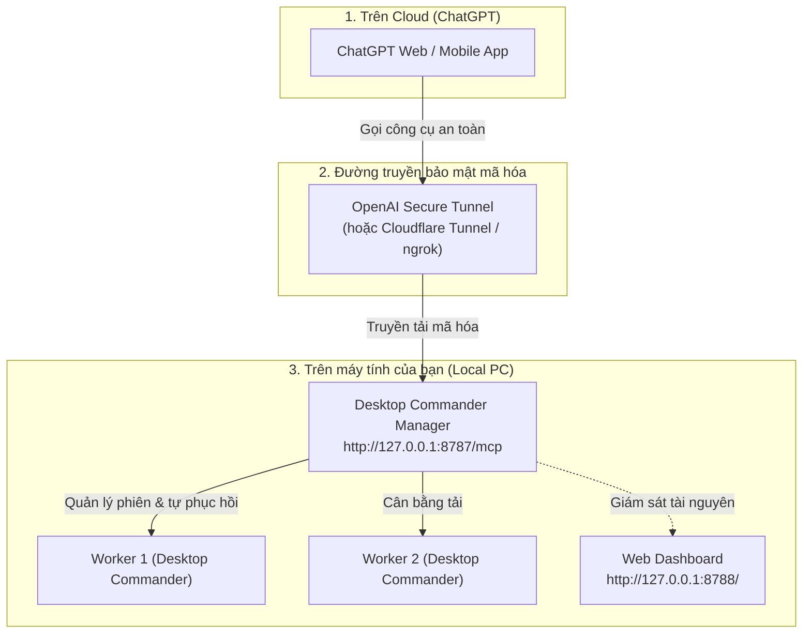
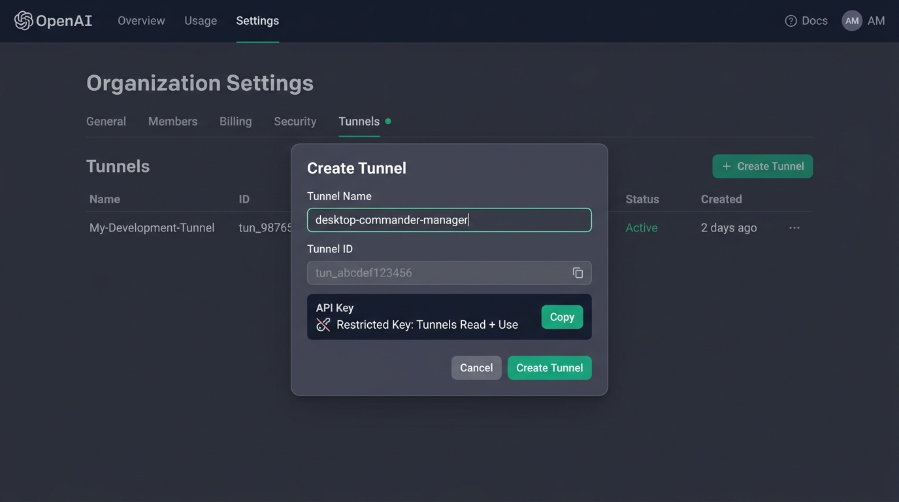
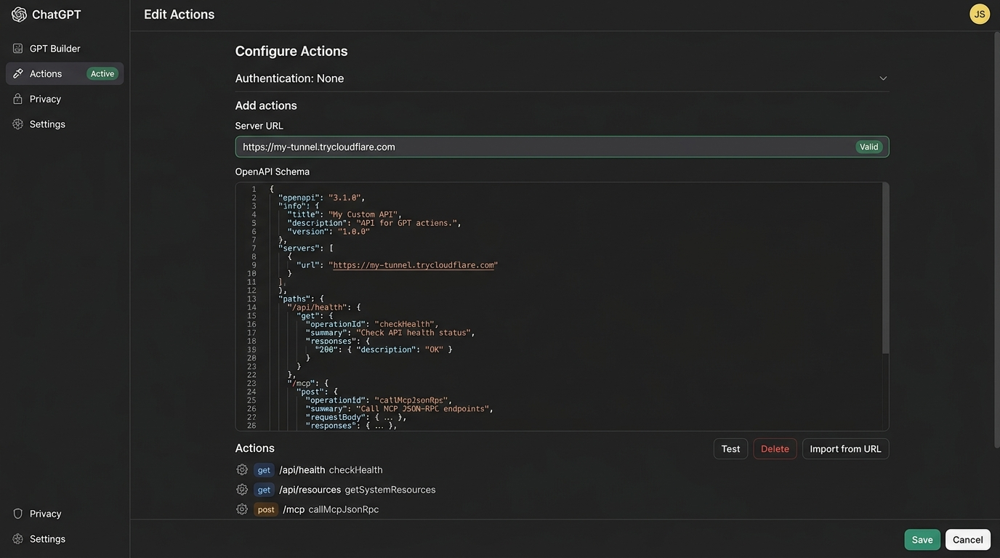
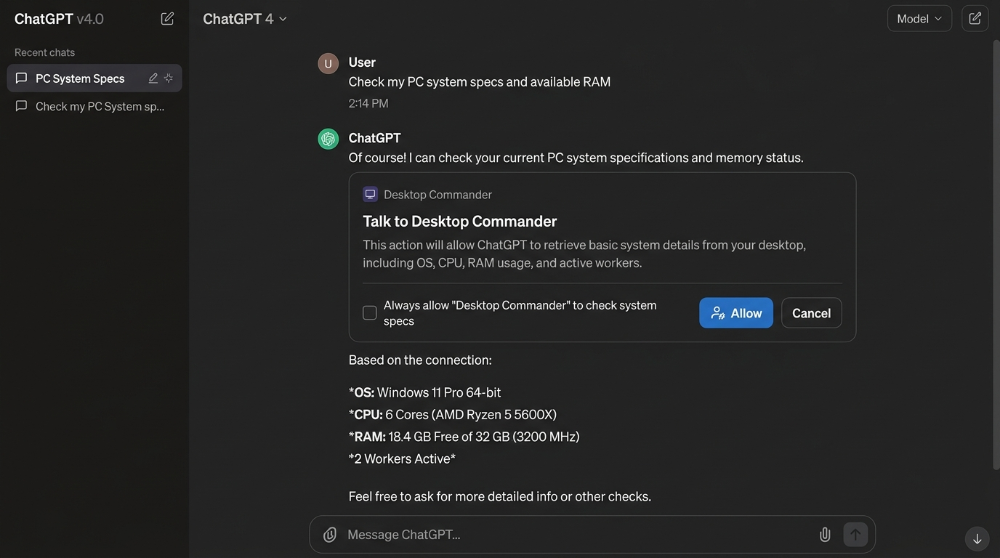

# 📖 Hướng dẫn chi tiết kết nối ChatGPT với Desktop Commander Manager (Có hình minh họa)

Tài liệu này hướng dẫn bạn từng bước cách kết nối **ChatGPT** với máy tính cá nhân thông qua **Desktop Commander Manager** để điều khiển máy tính, đọc/ghi file và chạy lệnh trực tiếp từ khung chat của ChatGPT.

---

## 🗺️ Sơ đồ luồng hoạt động tổng quan



---

## 🚀 Phương thức 1: Kết nối chính thức qua OpenAI Secure Tunnel (Khuyên dùng)

Đây là phương thức an toàn nhất của OpenAI: máy tính của bạn chỉ tạo kết nối outbound tới OpenAI, **không cần mở port**, **không lộ địa chỉ IP**, và tự động phục hồi kết nối.

### Bước 1: Khởi động Manager trên máy tính
1. Trong thư mục dự án hoặc bản tải về, click đúp file:
   ```text
   start-manager.bat
   ```
2. Mở trình duyệt kiểm tra: `http://127.0.0.1:8788/api/health` -> Thấy hiện `{"status":"ok"}` là server đã sẵn sàng.

---

### Bước 2: Tạo Tunnel và lấy API Key trên OpenAI Platform

1. Đăng nhập vào trang quản trị: [https://platform.openai.com/](https://platform.openai.com/)
2. Vào **Settings** -> **Organization** -> **Security** -> **Tunnels** (hoặc truy cập trực tiếp: `https://platform.openai.com/settings/organization/security/tunnels`).
3. Bấm nút xanh **+ Create Tunnel**.
4. Cửa sổ mở ra như hình dưới:



* **Tunnel Name:** Nhập tên bất kỳ (ví dụ: `desktop-commander-manager`).
* **Tunnel ID:** Sao chép lại mã ID (dạng `tun_abcdef123456...`).
* **API Key:** Vào mục **API Keys** -> Tạo một **Restricted Key** mới và chỉ cấp duy nhất quyền **Tunnels: Read + Use** -> Bấm **Copy** mã key (dạng `sk-...`).

---

### Bước 3: Cấu hình Tunnel tự động trên máy tính

1. Click đúp vào file:
   ```text
   setup-tunnel.bat
   ```
   *(Hoặc trên PowerShell: `powershell -ExecutionPolicy Bypass -File scripts/setup-tunnel.ps1`)*.
2. Dán **Tunnel ID** và **Restricted API Key** khi terminal hỏi.
   > 🔒 **Bảo mật:** API Key được lưu riêng biệt ngoài mã nguồn tại `%APPDATA%\tunnel-client\secrets` và được bảo vệ theo tài khoản Windows của bạn.
3. Kịch bản sẽ tự động chạy lệnh kiểm tra kết nối (`tunnel-client doctor`) và thiết lập tự khởi động ngầm.

---

### Bước 4: Kích hoạt trong ChatGPT

1. Mở [ChatGPT](https://chatgpt.com/).
2. Vào **Settings** -> **Developer Mode** -> **Apps / Connectors** (hoặc Custom GPT Tools).
3. Chọn loại kết nối là **OpenAI Secure Tunnel**.
4. Chọn đúng **Tunnel ID** vừa tạo.
5. ChatGPT sẽ tự động nhận diện tất cả các công cụ của Desktop Commander.

---

## 🧩 Phương thức 2: Dùng ChatGPT theo kiểu Plugin truyền thống (Custom GPT Action)

Nếu bạn muốn tạo một trợ lý riêng và có giao diện nút bấm gọi công cụ giống hệt **Plugin Store** trước đây:

### Bước 1: Mở cổng public an toàn bằng Cloudflare Tunnel
Mở terminal và chạy:
```bash
cloudflared tunnel --url http://127.0.0.1:8787
```
*(Hoặc dùng ngrok: `ngrok http 8787`)*. Bạn sẽ nhận được đường dẫn dạng: `https://my-tunnel.trycloudflare.com`.

---

### Bước 2: Thiết lập Action trong GPT Builder

1. Truy cập [GPT Builder](https://chatgpt.com/gpts/editor) -> Chọn **Create a GPT** -> Chọn tab **Configure**.
2. Kéo xuống dưới cùng nhấn **Create new action**.
3. Cấu hình các mục như hình minh họa:



* **Server URL:** Điền đường dẫn Cloudflare Tunnel bạn vừa nhận (ví dụ: `https://my-tunnel.trycloudflare.com`).
* **OpenAPI Schema:** Sao chép toàn bộ nội dung từ file [`docs/chatgpt-openapi-schema.json`](chatgpt-openapi-schema.json) và dán vào ô này.
* Sau khi dán, bạn sẽ thấy danh sách Actions hiển thị phía dưới:
  * `get /api/health`: Kiểm tra sức khỏe manager.
  * `get /api/resources`: Đo lường RAM và CPU thời gian thực.
  * `post /mcp`: Thực thi lệnh và thao tác file.
* **Authentication:** Chọn **None**.
* Nhấn **Save** ở góc trên bên phải (chọn *Only me*).

---

## 💬 Trải nghiệm thực tế khi chat với ChatGPT

Khi bạn mở cuộc trò chuyện với ChatGPT và gửi một yêu cầu:

> **User:** *"Check my PC system specs and available RAM"* (hoặc *"Kiểm tra cấu hình máy tính và dung lượng RAM trống"*).

ChatGPT sẽ chuẩn bị gọi công cụ và hiển thị hộp thoại xác nhận an toàn:



* **Hộp thoại xác nhận ("Talk to Desktop Commander"):**
  * Hiển thị thông báo xác nhận ChatGPT chuẩn bị gửi lệnh về máy bạn.
  * Bạn nhấn nút **Allow** (Cho phép một lần) hoặc tích chọn **Always allow** (Luôn cho phép).
* **Kết quả hiển thị:**
  * ChatGPT nhận dữ liệu từ máy của bạn và phản hồi trực tiếp: Hệ điều hành (OS), số nhân CPU, dung lượng RAM trống, số lượng worker đang chạy.

---

## 💡 Các câu lệnh mẫu bạn có thể thử ngay

1. **Kiểm tra máy tính:**
   > *"Cho tôi biết cấu hình chi tiết máy tính của tôi và những tiến trình nào đang chiếm nhiều RAM nhất?"*
2. **Đọc và xử lý file:**
   > *"Đọc file `D:\Projects\report.txt` và tóm tắt lại cho tôi 3 ý quan trọng."*
3. **Lập trình & Chạy thử:**
   > *"Tạo một file Python `D:\test.py` giải phương trình bậc 2, sau đó chạy thử file đó và in kết quả ra đây."*
4. **Quản lý thư mục:**
   > *"Liệt kê danh sách tất cả các file trong thư mục `D:\Downloads` và sắp xếp theo ngày sửa đổi gần nhất."*
